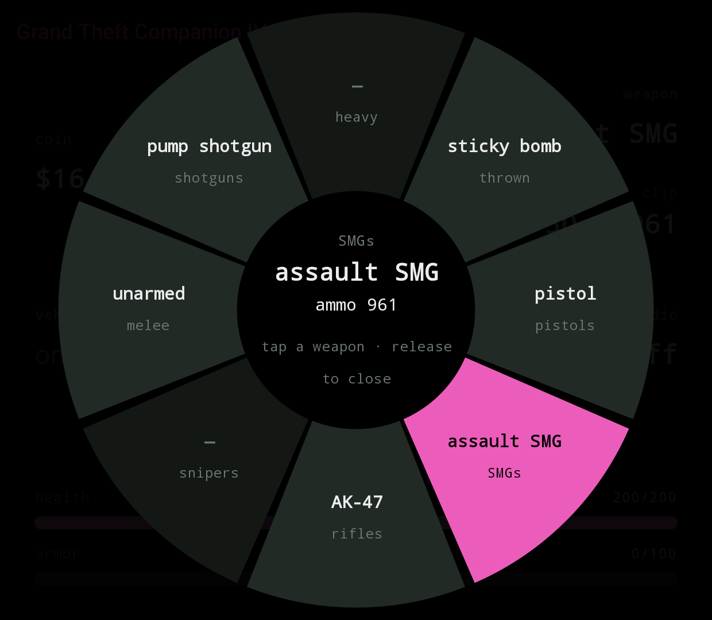
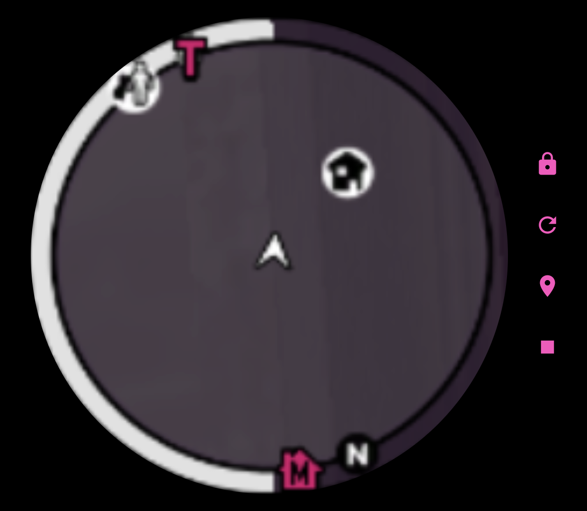
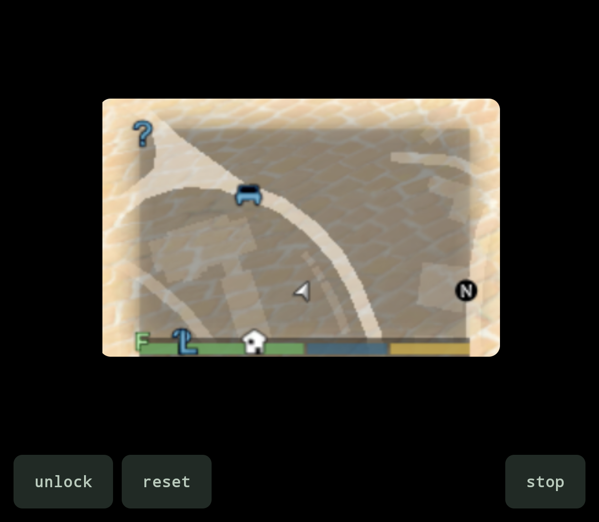
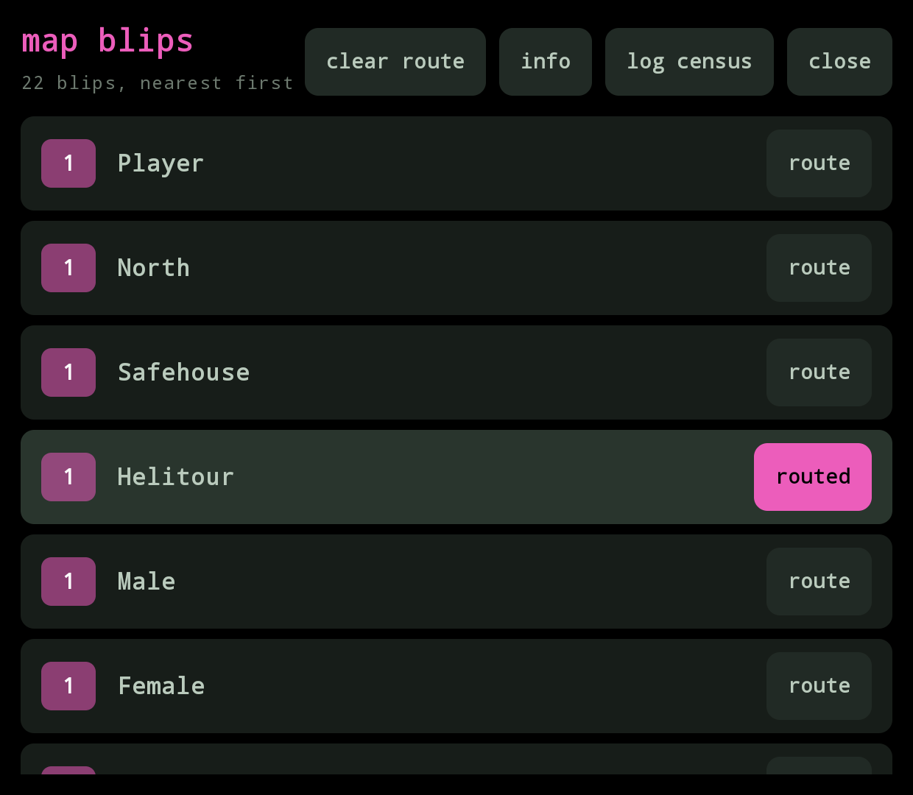
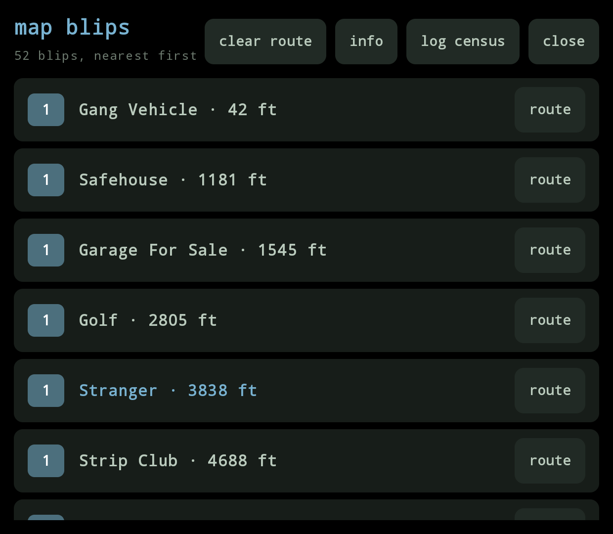
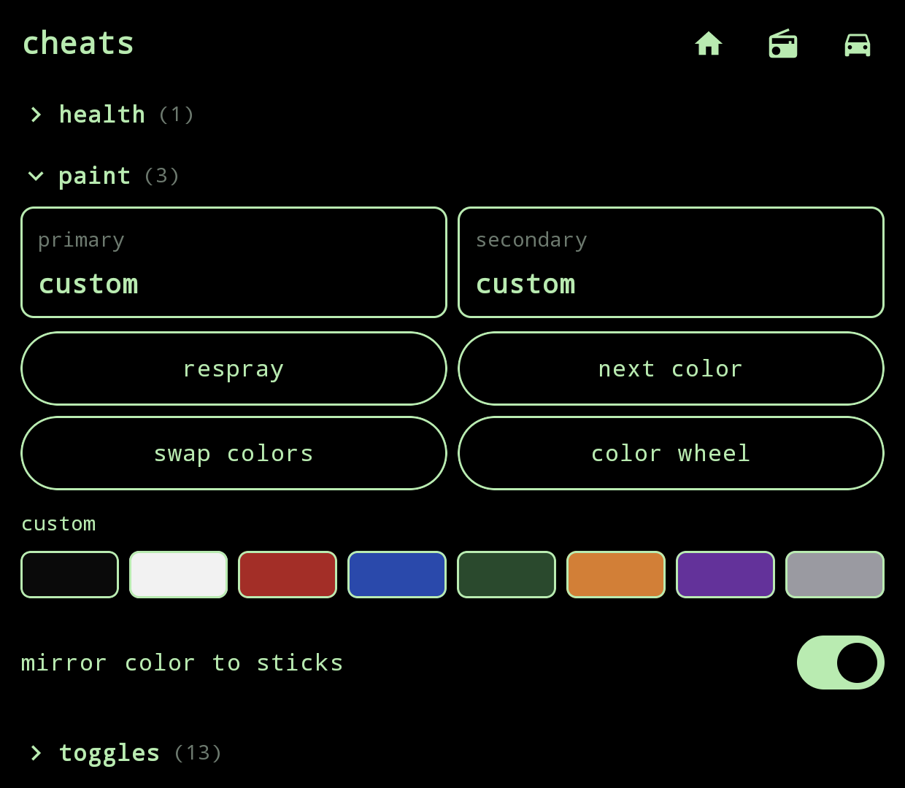
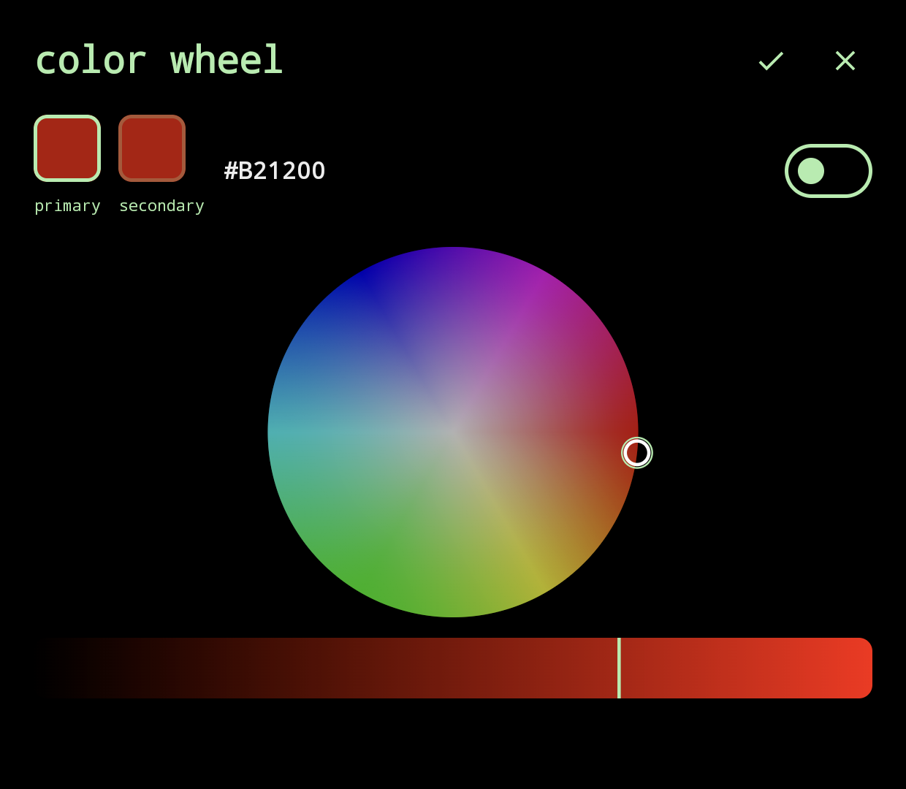

<p align="center">
  
</p>

# Grand Theft Companion

<p align="center">
  <a href="https://github.com/BrianJr03/GrandTheftCompanion/releases"></a>
  &nbsp;&nbsp;
  <a href="https://github.com/BrianJr03/GrandTheftCompanion/releases/latest"></a>
  &nbsp;&nbsp;
  <a href="https://github.com/BrianJr03/GrandTheftCompanion/releases/latest"></a>
</p>

AYN Thor bottom-screen companion for GTA IV and GTA V. Live HUD on the Thor's bottom screen while the game plays on the main screen via [GameHub Lite](https://www.gamehublite.com/), [GameNative](https://github.com/utkarshdalal/GameNative), any Winlator-family launcher, or [DroidDeck](https://github.com/Droid-Deck/DroidDeck) (Steam + Proton).

The repo contains the **GTC** Android companion app and two game plugins: **ThorBridge.asi** for GTA IV and **ThorBridgeV.asi** for GTA V. Each plugin reads game state from inside its game's process. The app is the same for both games and picks the right layout by itself.

<p align="center">
  
  &nbsp;&nbsp;
  
</p>

## Quick start

1. **A launcher on the Thor** — GameHub Lite / Winlator / Winlator Cmod / GameNative (Wine), or DroidDeck (Steam + Proton). The ASI loads inside its Wine/Proton prefix.
2. **Your own legit copy of the game** on-device:
   - GTA IV: Complete Edition **1.2.0.59** (the ASI pattern-scans this exact build).
   - GTA V (experimental): Legacy branch, on a build your [Script Hook V](http://www.dev-c.com/gtav/scripthookv) release lists as supported.
3. **Drop these files next to the game `.exe`** (same folder as `GTAIV.exe` / `GTA5.exe`):
   - **GTA IV** (two files):
     - `ThorBridge.asi` — from this project's [latest release](https://github.com/BrianJr03/GrandTheftCompanion/releases/latest).
     - `dinput8.dll` — the **32-bit** build from [Ultimate ASI Loader releases](https://github.com/ThirteenAG/Ultimate-ASI-Loader/releases) (file is named `dinput8.zip` inside the release — unzip and keep the DLL).
   - **GTA V** (three files):
     - `ThorBridgeV.asi` — from this project's [latest release](https://github.com/BrianJr03/GrandTheftCompanion/releases/latest).
     - `ScriptHookV.dll` **and** `dinput8.dll` — both from the `bin/` folder of the [Script Hook V zip](http://www.dev-c.com/gtav/scripthookv). Ignore `NativeTrainer.asi` and `xinput1_4.dll` unless you want them.

4. **Tell Wine to load the ASI loader** (native then builtin, so Wine uses our `dinput8.dll` instead of its own stub):
   - **Winlator-family launcher** — per-game env var: `WINEDLLOVERRIDES=dinput8=n,b`
   - **DroidDeck** — Steam launch options for the game:

     | Game | Launch options |
     |---|---|
     | GTA IV | `WINEDLLOVERRIDES="dinput8=n,b" %command%` |
     | GTA V | `WINEDLLOVERRIDES="dinput8=n,b" %command% -nobattleye` |
5. **Install the GTC APK** from the latest [release](https://github.com/BrianJr03/GrandTheftCompanion/releases/latest). Launch it once; the HUD trampolines onto the bottom display.
6. **Launch the game** from the launcher. HUD lights up the moment the game is in-world.

Prebuilt `ThorBridge.asi`, `ThorBridgeV.asi` and the signed APK are attached to each release.

## Downloads

Prebuilt artefacts (the APK and both ASI plugins) are attached to each [GitHub Release](https://github.com/BrianJr03/GrandTheftCompanion/releases/latest). The latest `main` build is always available as a workflow artefact under [Actions → build](https://github.com/BrianJr03/GrandTheftCompanion/actions/workflows/build.yml) (requires being signed into GitHub).

Three artefacts:

- **`app/`** — **GTC** (Grand Theft Companion), the Android app (Jetpack Compose + Hilt + MVVM, min SDK 33). A dedicated HUD Activity launched on the bottom display renders the HUD while the game plays on the main screen.
- **`asi/`** — `ThorBridge.asi`, the **GTA IV** plugin. A 32-bit Windows DLL (C++) that loads into GTA IV via Ultimate ASI Loader inside the launcher's Wine prefix.
- **`asi-v/`** — `ThorBridgeV.asi`, the **GTA V** plugin (story mode). A 64-bit Windows DLL (C++) that loads into GTA V alongside [Script Hook V](https://www.dev-c.com/gtav/scripthookv).

Both plugins read game state (money, health, armor, wanted level, weapon, vehicle, radio) and publish JSON over `127.0.0.1:47801` at 20 Hz. The companion sends commands the other way: retune the radio while driving, pick a weapon, route the GPS to a map blip, or fire a cheat from the cheats tab.

Licensed under **GPL-3.0-or-later** — see [LICENSE](LICENSE) and [LEGAL.md](LEGAL.md). Rockstar's **GTA IV and GTA V are not included and must not be redistributed with this project**; bring your own legitimately-purchased copy of the game.

## What you need

| | GTA IV | GTA V |
|---|---|---|
| Game build | Complete Edition 1.2.0.59 | any build your Script Hook V release supports |
| Plugin | `ThorBridge.asi` | `ThorBridgeV.asi` |
| ASI loader (`dinput8.dll`) | [Ultimate ASI Loader](https://github.com/ThirteenAG/Ultimate-ASI-Loader/releases), 32-bit | the one that ships with Script Hook V |
| Also needed | — | `ScriptHookV.dll` |
| Modes | story + both episodes | story mode only |

Plus, for either game: the GTC app, and a launcher that lets you set per-game environment variables.

## Roadmap

- **Broader device coverage** — only tested on the AYN Thor with
  GameHub Lite. The code paths are generic (secondary-display
  detection enumerates `FLAG_PRESENTATION` displays rather than
  hardcoding a display id; the plugins only need a Winlator-family
  launcher that honours `WINEDLLOVERRIDES`), but Odin / RG556 / RP5 /
  etc. are all unverified. Each new device needs: display enumeration
  confirmed, bottom-screen touch behaviour confirmed, ASI load path
  confirmed.
- **Auto-route to the next mission** — the blips panel is the
  manual half of this; the second half is a toggle that keeps the
  GPS pointed at the nearest mission start as the player drives
  around, switches targets only when a new one is meaningfully
  closer, and backs off while the game is already running a mission
  of its own.
- **GTA IV vehicle spawning** — the GTA IV cheats tab is missing the
  phone-cheat vehicle spawns (FIB Buffalo, Comet, Annihilator, …)
  because calling `REQUEST_MODEL` from the per-frame hook crashes
  the game. The infrastructure is already in the plugin; the fix is
  to swap it in for the game's own `SpawnCar(modelId)` entry point
  (pattern-scan, FusionFix-style). TLAD and TBoGT episode-only
  vehicles come along once that lands.

## Building

### GTA IV plugin

```
cd asi
./build.sh      # produces build/ThorBridge.asi (needs i686-w64-mingw32-g++)
```

### GTA V plugin

```
cd asi-v
./build.sh      # produces build/ThorBridgeV.asi (needs x86_64-w64-mingw32-g++)
```

Optional off-device test (needs 64-bit Wine):

```
./build.sh -DTHORBRIDGE_BUILD_MOCK=ON
python3 test/run_mock_test.py
```

### Android app (GTC)

```
./gradlew :app:assembleDebug    # produces app/build/outputs/apk/debug/app-debug.apk
./gradlew :app:installDebug     # install on a connected ADB device (Thor)
```

## Installing on-device

**Launcher**: install **GameHub Lite**, **Winlator** (or a fork such as **Winlator Cmod**), or **GameNative** — any launcher that lets you set per-game environment variables, needed for `WINEDLLOVERRIDES`. **DroidDeck** (0.4.0 or newer) also works: it runs the game through Steam and Proton, and the override goes in the game's Steam launch options instead (see below).

### Where is the game folder?

The plugin files go next to the game's exe (`GTAIV.exe` or `GTA5.exe`) inside your existing install. The game folder's path depends on how and where you installed it:

- **Shared storage**: any folder under `/storage/emulated/0/` (`/sdcard/`) is reachable by `adb push` directly.
- **Launcher app-private storage** (some launcher imports do this): the folder lives under `/sdcard/Android/data/<launcher.package>/files/...`. Also reachable via `adb push` on Android 13.
- **If you don't know where it is**, find it:
  ```
  adb shell "find /sdcard /storage -iname 'GTAIV.exe' 2>/dev/null"   # GTA IV
  adb shell "find /sdcard /storage -iname 'GTA5.exe' 2>/dev/null"    # GTA V
  ```
  Point `GAME_DIR` at whatever that returns (minus the exe name).

### Dropping the files — GTA IV

```
GAME_DIR='/sdcard/path/to/your/GTA IV folder'   # the folder containing GTAIV.exe

# ThorBridge.asi — from this repo's build or the GitHub release
adb push ThorBridge.asi "$GAME_DIR/"

# Ultimate ASI Loader (ThirteenAG) 32-bit — download the dinput8.dll
# from https://github.com/ThirteenAG/Ultimate-ASI-Loader/releases
adb push dinput8.dll "$GAME_DIR/"
```

If a `dinput8.dll` is already there from another mod (e.g. FusionFix or an earlier UAL install), you can usually leave it in place — UAL will chain-load any additional `.asi` files it finds alongside, which is exactly what we want.

### Dropping the files — GTA V

You need [Script Hook V](https://www.dev-c.com/gtav/scripthookv) by Alexander Blade, in a release that supports your exact game build. Download it from his site; it is not bundled here. Script Hook V refuses to run on builds it does not know, so when the game updates, wait for a matching Script Hook V release.

```
GAME_DIR='/sdcard/path/to/your/GTA V folder'   # the folder containing GTA5.exe

# From the Script Hook V download (bin/):
adb push ScriptHookV.dll "$GAME_DIR/"
adb push dinput8.dll     "$GAME_DIR/"    # Script Hook V's ASI loader

# ThorBridgeV.asi — from this repo's build or the GitHub release
adb push ThorBridgeV.asi "$GAME_DIR/"
```

### Launcher env var

**Winlator-family launchers** (GameHub Lite, Winlator, GameNative): the same for both games. Open the game's settings → Environment variables and add:
`WINEDLLOVERRIDES = dinput8=n,b` (native then builtin — forces Wine to load the ASI loader instead of its own `dinput8`).

### DroidDeck

DroidDeck runs Windows games through Steam Big Picture and Valve's ARM64 Proton. GTC needs nothing extra from it; the plugins bind the same `127.0.0.1:47801` and the app connects the same way.

1. Put the plugin files next to the exe as above (any folder you can browse to, e.g. `Download/GTAIV`).
2. In DroidDeck open the **Games** tab → **+** → *Internal storage* → browse to the folder and pick `GTAIV.exe` / `GTA5.exe` yourself (don't let the folder scan pick the Rockstar launcher exe). DroidDeck needs *All files access* to see the folder.
3. In Steam, open the game's **Properties → Launch Options** and paste the line for your game. Everything before `%command%` is an environment variable; everything after it is passed to the game.

   | Game | Launch options |
   |---|---|
   | GTA IV | `WINEDLLOVERRIDES="dinput8=n,b" %command%` |
   | GTA V | `WINEDLLOVERRIDES="dinput8=n,b" %command% -nobattleye` |

   `-nobattleye` is Rockstar's own story-mode switch for GTA V; GTA IV doesn't need it. Don't add `%*`.
4. Launch from Steam. If no `ThorBridge.log` / `ThorBridgeV.log` appears next to the exe, the launch options didn't apply — the "Start without Steam" switch (0.5.0+) bypasses them, so leave it off, or put `WINEDLLOVERRIDES=dinput8=n,b` in the game's environment-variables field in the Games tab instead.
5. If LB doesn't open the weapon wheel, Steam Input is remapping the controller before the game sees it. Disable Steam Input for the game in its Properties → Controller.

### Run it

Launch the game as normal, load a save (story mode for GTA V), then open GTC. It opens on the bottom screen and connects by itself. If you quit one game and start the other, GTC switches layout on its own.

### Troubleshooting

Each plugin writes a log next to its game's exe:

| | GTA IV | GTA V |
|---|---|---|
| Plugin log | `ThorBridge.log` | `ThorBridgeV.log` |
| Other logs | — | `ScriptHookV.log` |

On GTA V, if Script Hook V is missing or rejects the game build, the companion says so on screen instead of showing a HUD.

## How the two plugins differ

The plugins share a wire protocol and port (`127.0.0.1:47801`; GTA V frames are tagged `"game":"v"`) but nothing else:

| | GTA IV (`asi/`) | GTA V (`asi-v/`) |
|---|---|---|
| Process | 32-bit | 64-bit |
| How it reads the game | pattern-scans the exe, calls natives directly | calls natives through [Script Hook V](https://www.dev-c.com/gtav/scripthookv) |
| Game builds | Complete Edition 1.2.0.59 only | whatever your Script Hook V release supports (Legacy and Enhanced) |
| Code patches / hooks | one per-frame call-site detour | none |
| Status | verified on an AYN Thor with GameHub Lite, including The Lost and Damned and The Ballad of Gay Tony | verified on an AYN Thor with GameHub Lite against GTA V 1.0.3751.0 + Script Hook V v3889.0 |

Issues welcome for either game — please attach the plugin log.

### The HUD on each game

The app picks the layout from the plugin's hello frame. Both layouts share the same cards: money, weapon and ammo, vehicle and speed, radio, with health and armor bars underneath and a tappable radio picker while driving.

**GTA IV** tints the HUD by episode (GTA IV, The Lost and Damned, The Ballad of Gay Tony) and shows six wanted stars.

**GTA V** adds what only GTA V has:

- **Three protagonists** — accent colour, name and cash follow whoever you are playing (Michael / Franklin / Trevor); a "switching…" screen covers the character-switch camera.
- **Special ability** bar (ready / active / charging — the game exposes states, not a level).
- **Five** wanted stars instead of six.
- **Vehicle class** on the vehicle card, altitude for aircraft, no engine bar on bicycles, "no radio" where the vehicle has none.
- **Long-press the vehicle card** to open **[Los Santos Customs](#los-santos-customs-gta-v)** — body, performance, wheels, interior, lights, plate, tint, neon, bulletproof tyres, plus Paint and fix vehicle. A small pencil glyph next to the vehicle name advertises it.
- **Radio picker built from the running game's own station list**, matched by station name rather than index, so DLC stations and build-to-build reordering don't break it.
- Tags for mission / cutscene / animal form; non-protagonist peds (Director Mode) get a neutral palette with cash and special hidden.
- **Story mode only.** In GTA Online the plugin publishes nothing but an "online" flag (and Script Hook V itself closes the game on entering Online).

**First-visit tour** — on both games the HUD page shows a quick onboarding sheet the first time you land on it with a live game. Three slides on GTA IV (cards, taps, tabs), four on GTA V (adds a "long-press the vehicle card" slide for Customs). Dismissed state is persisted; a **Show tips again** row under Settings → Cheats brings every first-visit sheet back.

### Weapon Wheel

<p align="center">
  
</p>

An eight-slot wheel on the bottom screen, laid out like GTA V's: pistols right, rifles down, melee left, heavy up. Tap a slot to switch weapon; tap the already-selected slot again to step through its other weapons.

Opens two ways: tap the on-foot weapon card, or **hold LB / L1** on the pad. Releasing LB closes it. A tap-opened wheel closes by itself after a few seconds of no input. There are no weapon icons — the game's are Rockstar's artwork and this project ships none, so slots are labelled in text.

**GTA IV is the one that benefits most**: it has no in-game weapon wheel. Rockstar's HUD only cycles through the slots one at a time with the shoulder buttons, so picking a specific weapon in a hurry means tapping through everything you own. GTC gives it the direct-pick wheel the base game never had, carrying every weapon from the base game, The Lost and Damned and The Ballad of Gay Tony.

**GTA V** keeps its own wheel on the top screen; the companion's is a touch-friendly mirror on the bottom. The equipped weapon follows whichever wheel finishes last, so you can start with the pad and finish with a tap, or the other way around.

### MiniMap View

<table align="center">
  <tr>
    <td align="center"></td>
    <td align="center"></td>
  </tr>
  <tr>
    <td align="center"><em>GTA IV</em></td>
    <td align="center"><em>GTA V</em></td>
  </tr>
</table>

Once connected, the bottom screen is a three-page pager laid out left-to-right as **cheats**, HUD, **map**. The HUD sits in the middle, one swipe either way. A one-time **Tip** dialog on first connect points this out. The pager always cold-starts on the HUD and resets to the HUD when you switch between IV and V.

The map page mirrors the game's own minimap from the top screen and enlarges it, using Android's screen-capture permission. Tap **start mirroring** and approve the system prompt. Android asks again each session. It needs no plugin update and ships no map imagery. It shows exactly what the game draws, blips and GPS route included. GTA IV is clipped to a circle to match its native radar; GTA V stays rectangular to match its map.

- The crop is a per-game preset measured at default HUD settings. If yours is off, **unlock** the map and pinch to zoom or drag to pan until it fits. Tap **lock** when you are happy with it so swiping between pages won't nudge it. Positions are saved per game and persist across restarts. **Reset** returns to the preset.
- It is a magnified copy of a small patch of the screen, so it is soft, and it shows whatever is in that patch when the game hides the minimap (cutscenes, pause menu).
- Frames are only mirrored while the map page is visible, but the capture session (and Android's capture indicator) stays until you tap **stop** or close the app.
- When the game is paused (or GTA V shows an on-screen notice like a character switch), the pause screen takes over both pages. Swipe is disabled until the game resumes.

### Blips View

<table align="center">
  <tr>
    <td align="center"></td>
    <td align="center"></td>
  </tr>
  <tr>
    <td align="center"><em>GTA IV</em></td>
    <td align="center"><em>GTA V</em></td>
  </tr>
</table>

Every icon on the game's own map, nearest first, grouped by name, with a one-tap **route** button per icon. Opens the game's own GPS to that destination without having to pause and move a map cursor. Works on both games.

Open it two ways:
- The pin icon in the HUD status bar (both games, both pager pages). It mirrors the title's accent while the connection is live and fades out when stale.
- **Dpad-down** on GTA IV. The plugin reads the game's own pad state so the key never has to reach the companion. GTA V has no stable control id for a raw dpad-down (the game remaps it in a vehicle), so the pin icon is the only way there.

Tap a group header to expand it; multiple instances of the same icon (several Ammu-Nations, every Pay 'n' Spray) collapse into one row with a count on the leading badge. Single-item groups route in one tap. Tapping an already-routed row clears the route. Expanding one group collapses the rest with an animation so the panel stays focused on what you picked.

- **GTA V** shows distances in feet / miles and tints known mission-starter icons (Michael / Franklin / Trevor, strangers, heists, mission objectives) with the character accent.
- **GTA IV** hides distance because `GET_BLIP_COORDS` only returns real coordinates for a subset of blip types; children of multi-item groups show `#1`, `#2` indices instead. Named contacts (Roman, Little Jacob, Playboy X, Johnny, Tony, …) are tinted with the episode accent.

Labels are provisional; the plugin reports every blip's raw sprite id, and the companion looks up a short English name from a seeded table. Anything the table does not know shows as `Sprite N`. The **info** button in the panel header links to the repo's issues page — route to an unknown row, see where it leads, open an issue with the sprite number and the name, it will be added to the next build once verified.

### Cheats

A third tab for one-tap cheats, grouped into collapsible sections (health, wanted, weapons, vehicle, world, toggles). All sections start open; tap a header to collapse the ones you don't care about. Collapsed sections are remembered across app launches.

**GTA IV** carries the base-game phone-cheat set: heal, wanted +1 / clear, all weapons, max ammo, fix vehicle, next weather, next time of day, parachute, and the three named weapon-set cheats (advanced, poor, and the ultimate 482-555-0100 combo). Toggles: invincible, fast reload, never tired, slow motion, police ignore. Vehicle spawning is deferred; the game's phone keeps working for those.

**GTA V** adds every gameplay cheat from GTA V's own phone-cheat list: wanted -1, fill special, skyfall, six spawn-car buttons (adder, zentorno, bati, sanchez, frogger, bmx), plus toggles for infinite clip, fast run, low gravity, drunk, fast swim, super jump, explosive ammo, explosive melee, incendiary ammo, and slippery cars.

Toggle lights come from what the game reports, not from the tap, so a toggle the game refuses never looks on. Tapped something that didn't work? The last refusal shows as a short red line at the bottom in the plugin's own words.

GTA V flags the save as cheated the first time you tap a cheat, same as entering the code on the phone, so cheated saves block Achievements / Trophies for that session. GTA IV has no equivalent flag.

### Paint

A **Paint** section inside the Cheats tab turns the Thor into a bottom-screen Pay 'n' Spray. Four buttons on both games (**respray**, **next color**, **swap colors**, plus a GTA V–only **color wheel** button), a row of eight custom-color swatches on GTA V, and a mirror-to-sticks toggle that pipes the car's current paint to the AYN Thor's analog-stick lights.



- **respray** picks a fresh random palette pair and repairs + washes the car, like the real shop. Reads two indices into the game's `carcols` palette.
- **next color** steps the primary color one entry along the palette, secondary unchanged.
- **swap colors** flips primary and secondary.
- The two **primary / secondary** boxes at the top show the current palette indices from the plugin, or the word "custom" (GTA V) when the car carries an RGB override on either layer. The pair comes from the state frame — never from the tap — so a write the game refused never looks like it took.
- The eight **swatches** below the buttons (GTA V only) are our picks: night, bone, red, blue, racing green, orange, purple, chrome. Not the game's `carcols` names; the game's palette tables are the game's data.
- **mirror color to sticks** (GTA V only, bottom of the section): when on, every color wheel / swatch pick is also sent to the Thor's thumbstick rings via Bifrost, so the car and the controller match. Police lights still win while the player is wanted; the sticks go back to the paint color once the stars drop.

The **color wheel** is a full-screen HSV picker: hue + saturation on the ring, value on the slider underneath.



- Two preview tiles up top. **Tap either tile** to select that layer for editing — the active one gets the bright accent border, the other dims. No separate switch; the previews themselves are the switcher.
- Two header icons: **apply both** sends two paint commands back-to-back (one per layer) so a different primary and secondary land in one trip. **apply active** writes only the layer you were editing and leaves the other one alone.
- Each layer keeps its own hue / saturation / value while the sheet is composed, so changing primary, applying, reopening, and tapping secondary leaves primary exactly where you left it.
- The paint command carries a layer selector in the top byte of its argument, so the plugin writes only the layer you were editing — the other one is left alone unless you asked for both.
- The horizontal pager locks while the sheet is up, so dragging on the wheel never pulls you back to the HUD tab.

Paint on GTA V uses eight game natives (two color readers, two palette setters, two custom-RGB setters, two custom-RGB clearers), each hash verified against the community `nativedb`. GTA IV uses two (`CHANGE_CAR_COLOUR`, `GET_CAR_COLOURS`); custom RGB and the color wheel are GTA V–only — IV has no custom-color native, so the color wheel button is hidden and `paint_rgb` is refused with "not in this game".

### Los Santos Customs (GTA V)

A full-screen **Customs** sheet that puts every mod Los Santos Customs sells on the Thor's bottom panel. A small pencil glyph sits next to the vehicle name on the HUD's vehicle card; **long-press the card** while sitting in a car and the sheet slides up with the Paint section on top and every modifiable slot the game exposes below.

- **Paint** at the top: respray, next color, swap colors, color wheel, fix vehicle, plus the same eight-swatch strip the Cheats tab's Paint section uses. Fire-and-forget — the sheet stays open so you can keep tweaking.
- **Body / Performance / Wheels / Interior / Lights & extras / Plate** sections underneath, each collapsible. Every slot the current car exposes shows up with the game's own localized label (coming through `GET_MOD_SLOT_NAME` + `GET_LABEL_TEXT`); slots the game has no name for fall back to Rockstar's `eVehicleModType` enum names (spoiler, front bumper, hood, engine, brakes, suspension, …).
- Each slot has ◀ ▶ arrows that wrap through "stock" so you can preview every option in order; the row's label follows the plugin's reply, never the tap, so a write the game refused never looks like it landed.
- The three toggle slots (turbo, tyre smoke, xenon lights) render as switches instead of arrows, because the game exposes them that way.
- Wheel type switcher re-lists the wheels when you change it, since each wheel type carries its own option count.
- Plate text field with inline validation ([A–Z 0–9 space], up to 8 chars) and an **Apply** button that drops focus and closes the IME. Plate style picker next to it.
- Neon and tyre-smoke rows share the Paint swatch strip; neon gets an **off** button to clear all four sides at once. Xenon color is a ◀ ▶ list over the game's thirteen presets plus a default.
- Bulletproof tyres switch at the bottom.
- The sheet closes if you get out of the car for more than three seconds (a brief stall mid-mission won't slam it shut), and reopens with the catalogue for whatever car you climb into next.

The plugin side walks modType 0..48 on the script fiber a slice at a time (eight slots per tick) so a crowded car's catalogue arrives in a few hundred ms without ever hitching the game. Twenty-six new natives on top of what Paint already uses, every hash verified against `nativedb`. GTA IV has no mod kit natives, so the whole feature is V-only and the pencil glyph never appears on the IV HUD.

### Wanted stick lights (AYN Thor)

When the player picks up a wanted level, the Thor's analog-stick RGB rings flash red and blue like a police light bar, one stick red and the other blue, trading places on each beat. More stars means a faster beat (around 600 ms at one star, down to 400 ms at full stars). The sticks go dark again the moment you lose the cops, and stay off during pause, loading, GTA Online, or a character switch.

- Driven through AYN's **Bifrost** service, so it only lights up on a Thor. Other devices just ignore it.
- Toggle it from the small lights icon in the HUD status bar. The icon also shows if Bifrost is not accepting commands right now.
- Half brightness on purpose. Full-brightness red and blue reads as harsh on the AMOLED stick rings at arm's length.

## A note on AI usage

This app was built, tested, and iterated on this project (both C++ ASI plugins and the Android companion) in collaboration with Anthropic's Claude. Pattern-scan work, the Script Hook V binding, Compose UI, release signing, and most of what's in `git log` was pair-programmed with it.

Everything that landed in the repo was reviewed, tested on-device (an AYN Thor + legitimate copy of GTA IV: Complete Edition 1.2.0.59, and GTA V 1.0.3751.0 with Script Hook V v3889.0), and signed off by @BrianJr03. Issues and PRs welcome.
