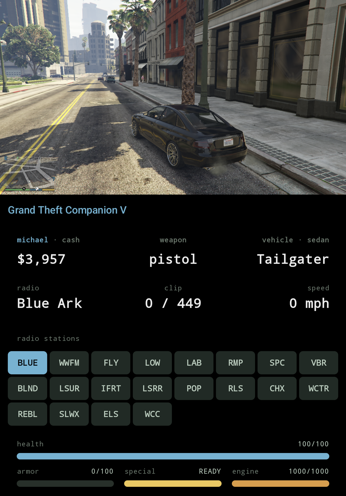

<p align="center">
  
</p>

# Grand Theft Companion

AYN Thor bottom-screen companion for GTA IV and GTA V. Live HUD on the Thor's bottom screen while the game plays on the main screen via [GameHub Lite](https://www.gamehublite.com/), [GameNative](https://github.com/utkarshdalal/GameNative), or any Winlator-family launcher.

The repo contains the **GTC** Android companion app and two game plugins: **ThorBridge.asi** for GTA IV and **ThorBridgeV.asi** for GTA V. Each plugin reads game state from inside its game's process. The app is the same for both games and picks the right layout by itself.

<p align="center">
  
  &nbsp;&nbsp;
  
</p>

## Downloads

Prebuilt artefacts (the APK and both ASI plugins) are attached to each [GitHub Release](https://github.com/BrianJr03/GrandTheftCompanion/releases/latest). The latest `main` build is always available as a workflow artefact under [Actions → build](https://github.com/BrianJr03/GrandTheftCompanion/actions/workflows/build.yml) (requires being signed into GitHub).

Three artefacts:

- **`app/`** — **GTC** (Grand Theft Companion), the Android app (Jetpack Compose + Hilt + MVVM, min SDK 33). A dedicated HUD Activity launched on the bottom display renders the HUD while the game plays on the main screen.
- **`asi/`** — `ThorBridge.asi`, the **GTA IV** plugin. A 32-bit Windows DLL (C++) that loads into GTA IV via Ultimate ASI Loader inside the launcher's Wine prefix.
- **`asi-v/`** — `ThorBridgeV.asi`, the **GTA V** plugin (story mode). A 64-bit Windows DLL (C++) that loads into GTA V alongside [Script Hook V](https://www.dev-c.com/gtav/scripthookv).

Both plugins read game state (money, health, armor, wanted level, weapon, vehicle, radio) and publish JSON over `127.0.0.1:47801` at 20 Hz. While you're driving, tapping a station on the bottom screen retunes the radio.

Licensed under **GPL-3.0-or-later** — see [LICENSE](LICENSE) and [LEGAL.md](LEGAL.md). Rockstar's **GTA IV and GTA V are not included and must not be redistributed with this project**; bring your own legitimately-purchased copy of the game.

## What you need

| | GTA IV | GTA V |
|---|---|---|
| Game build | Complete Edition 1.2.0.59 | any build your Script Hook V release supports |
| Plugin | `ThorBridge.asi` | `ThorBridgeV.asi` |
| ASI loader (`dinput8.dll`) | [Ultimate ASI Loader](https://github.com/ThirteenAG/Ultimate-ASI-Loader/releases), 32-bit | the one that ships with Script Hook V |
| Also needed | — | `ScriptHookV.dll` |
| Modes | story + both episodes | story mode only |

Plus, for either game: the GTC app, and a launcher that lets you set per-game environment variables.

## Roadmap

- **Weapon picker**

- **Broader device coverage** — only tested on the AYN Thor with
  GameHub Lite. The code paths are generic (secondary-display
  detection enumerates `FLAG_PRESENTATION` displays rather than
  hardcoding a display id; the plugins only need a Winlator-family
  launcher that honours `WINEDLLOVERRIDES`), but Odin / RG556 / RP5 /
  etc. are all unverified. Each new device needs: display enumeration
  confirmed, bottom-screen touch behaviour confirmed, ASI load path
  confirmed.

## Building

### GTA IV plugin

```
cd asi
./build.sh      # produces build/ThorBridge.asi (needs i686-w64-mingw32-g++)
```

### GTA V plugin

```
cd asi-v
./build.sh      # produces build/ThorBridgeV.asi (needs x86_64-w64-mingw32-g++)
```

Optional off-device test (needs 64-bit Wine):

```
./build.sh -DTHORBRIDGE_BUILD_MOCK=ON
python3 test/run_mock_test.py
```

### Android app (GTC)

```
./gradlew :app:assembleDebug    # produces app/build/outputs/apk/debug/app-debug.apk
./gradlew :app:installDebug     # install on a connected ADB device (Thor)
```

## Installing on-device

**Launcher**: install **GameHub Lite**, **Winlator** (or a fork such as **Winlator Cmod**), or **GameNative** — any launcher that lets you set per-game environment variables, needed for `WINEDLLOVERRIDES`.

### Where is the game folder?

The plugin files go next to the game's exe (`GTAIV.exe` or `GTA5.exe`) inside your existing install. The game folder's path depends on how and where you installed it:

- **Shared storage**: any folder under `/storage/emulated/0/` (`/sdcard/`) is reachable by `adb push` directly.
- **Launcher app-private storage** (some launcher imports do this): the folder lives under `/sdcard/Android/data/<launcher.package>/files/...`. Also reachable via `adb push` on Android 13.
- **If you don't know where it is**, find it:
  ```
  adb shell "find /sdcard /storage -iname 'GTAIV.exe' 2>/dev/null"   # GTA IV
  adb shell "find /sdcard /storage -iname 'GTA5.exe' 2>/dev/null"    # GTA V
  ```
  Point `GAME_DIR` at whatever that returns (minus the exe name).

### Dropping the files — GTA IV

```
GAME_DIR='/sdcard/path/to/your/GTA IV folder'   # the folder containing GTAIV.exe

# ThorBridge.asi — from this repo's build or the GitHub release
adb push ThorBridge.asi "$GAME_DIR/"

# Ultimate ASI Loader (ThirteenAG) 32-bit — download the dinput8.dll
# from https://github.com/ThirteenAG/Ultimate-ASI-Loader/releases
adb push dinput8.dll "$GAME_DIR/"
```

If a `dinput8.dll` is already there from another mod (e.g. FusionFix or an earlier UAL install), you can usually leave it in place — UAL will chain-load any additional `.asi` files it finds alongside, which is exactly what we want.

### Dropping the files — GTA V

You need [Script Hook V](https://www.dev-c.com/gtav/scripthookv) by Alexander Blade, in a release that supports your exact game build. Download it from his site; it is not bundled here. Script Hook V refuses to run on builds it does not know, so when the game updates, wait for a matching Script Hook V release.

```
GAME_DIR='/sdcard/path/to/your/GTA V folder'   # the folder containing GTA5.exe

# From the Script Hook V download (bin/):
adb push ScriptHookV.dll "$GAME_DIR/"
adb push dinput8.dll     "$GAME_DIR/"    # Script Hook V's ASI loader

# ThorBridgeV.asi — from this repo's build or the GitHub release
adb push ThorBridgeV.asi "$GAME_DIR/"
```

### Launcher env var

The same for both games. In your launcher, open the game's settings → Environment variables and add:
`WINEDLLOVERRIDES = dinput8=n,b` (native then builtin — forces Wine to load the ASI loader instead of its own `dinput8`).

### Run it

Launch the game as normal, load a save (story mode for GTA V), then open GTC. It opens on the bottom screen and connects by itself. If you quit one game and start the other, GTC switches layout on its own.

### Troubleshooting

Each plugin writes a log next to its game's exe:

| | GTA IV | GTA V |
|---|---|---|
| Plugin log | `ThorBridge.log` | `ThorBridgeV.log` |
| Other logs | — | `ScriptHookV.log` |

On GTA V, if Script Hook V is missing or rejects the game build, the companion says so on screen instead of showing a HUD.

## How the two plugins differ

The plugins share a wire protocol and port (`127.0.0.1:47801`; GTA V frames are tagged `"game":"v"`) but nothing else:

| | GTA IV (`asi/`) | GTA V (`asi-v/`) |
|---|---|---|
| Process | 32-bit | 64-bit |
| How it reads the game | pattern-scans the exe, calls natives directly | calls natives through [Script Hook V](https://www.dev-c.com/gtav/scripthookv) |
| Game builds | Complete Edition 1.2.0.59 only | whatever your Script Hook V release supports (Legacy and Enhanced) |
| Code patches / hooks | one per-frame call-site detour | none |
| Status | verified on an AYN Thor with GameHub Lite, including The Lost and Damned and The Ballad of Gay Tony | verified on an AYN Thor with GameHub Lite against GTA V 1.0.3751.0 + Script Hook V v3889.0 |

Issues welcome for either game — please attach the plugin log.

### The HUD on each game

The app picks the layout from the plugin's hello frame. Both layouts share the same cards: money, weapon and ammo, vehicle and speed, radio, with health and armor bars underneath and a tappable radio picker while driving.

**GTA IV** tints the HUD by episode (GTA IV, The Lost and Damned, The Ballad of Gay Tony) and shows six wanted stars.

**GTA V** adds what only GTA V has:

- **Three protagonists** — accent colour, name and cash follow whoever you are playing (Michael / Franklin / Trevor); a "switching…" screen covers the character-switch camera.
- **Special ability** bar (ready / active / charging — the game exposes states, not a level).
- **Five** wanted stars instead of six.
- **Vehicle class** on the vehicle card, altitude for aircraft, no engine bar on bicycles, "no radio" where the vehicle has none.
- **Radio picker built from the running game's own station list**, matched by station name rather than index, so DLC stations and build-to-build reordering don't break it.
- Tags for mission / cutscene / animal form; non-protagonist peds (Director Mode) get a neutral palette with cash and special hidden.
- **Story mode only.** In GTA Online the plugin publishes nothing but an "online" flag (and Script Hook V itself closes the game on entering Online).

## A note on AI usage

This app was built, tested, and iterated on this project (both C++ ASI plugins and the Android companion) in collaboration with Anthropic's Claude. Pattern-scan work, the Script Hook V binding, Compose UI, release signing, and most of what's in `git log` was pair-programmed with it.

Everything that landed in the repo was reviewed, tested on-device (an AYN Thor + legitimate copy of GTA IV: Complete Edition 1.2.0.59, and GTA V 1.0.3751.0 with Script Hook V v3889.0), and signed off by @BrianJr03. Issues and PRs welcome.
