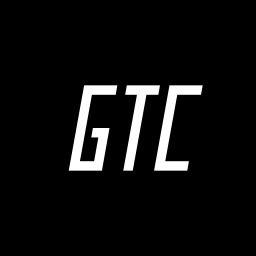
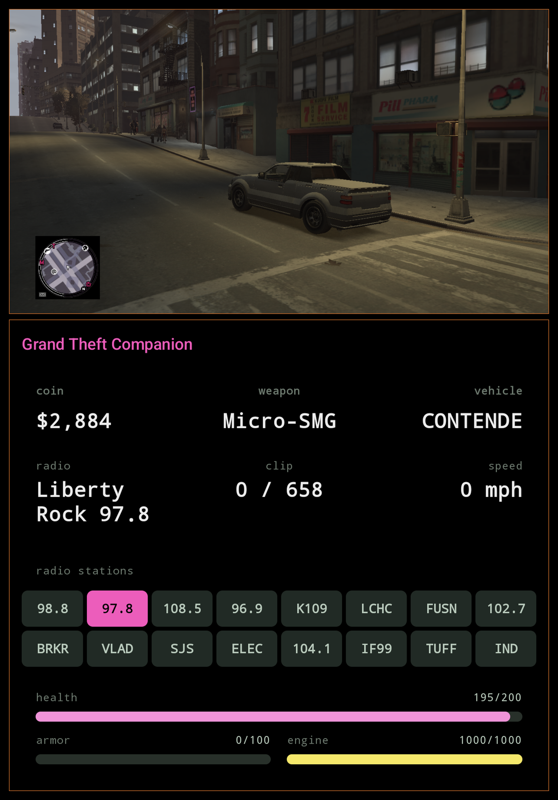

<p align="center">
  
</p>

# Grand Theft Companion

**GTC**: AYN Thor bottom-screen companion for GTA IV. Live HUD on the Thor's bottom screen while GTA IV plays on the main screen via [GameHub Lite](https://www.gamehublite.com/) (`gamehub.lite`) or any Winlator-family launcher.

Repo contains the **GTC** Android companion app and **ThorBridge.asi**, the ASI plugin that reads game state from inside the GTA IV process.

**GTA V (story mode) support is experimental** — a second plugin, **ThorBridgeV.asi**, and a GTA V layout in the app. See [GTA V](#gta-v-experimental).

<p align="center">
  
</p>

## Downloads

Prebuilt artefacts (debug APK + ASI) are attached to each [GitHub Release](https://github.com/BrianJr03/GrandTheftCompanion/releases/latest). The latest `main` build is always available as a workflow artefact under [Actions → build](https://github.com/BrianJr03/GrandTheftCompanion/actions/workflows/build.yml) (requires being signed into GitHub).

Two artifacts:

- **`asi/`** — `ThorBridge.asi`, a 32-bit Windows DLL (C++) that loads into GTA IV via Ultimate ASI Loader inside GameHub Lite's Wine prefix. Reads game state (money, health, armor, weapon, vehicle, radio) and publishes JSON over `127.0.0.1:47801` at 20 Hz.
- **`app/`** — **GTC** (Grand Theft Companion), the Android app (Jetpack Compose + Hilt + MVVM, min SDK 33). A dedicated HUD Activity launched on the bottom display renders the HUD while GTA IV plays on the main screen.

Licensed under **GPL-3.0-or-later** — see [LICENSE](LICENSE) and [LEGAL.md](LEGAL.md). Rockstar's **GTA IV is not included and must not be redistributed with this project**; bring your own legitimately-purchased copy of Complete Edition 1.2.0.59.

## Roadmap

- **Weapon picker** 

- **GTA V on-device verification** — `asi-v/` and the GTA V layout
  are written and mock-tested but have not been run against the real
  game on a Thor yet. Open questions: Script Hook V under Wine on ARM,
  what the plugin sees while the game is paused, radio-station list
  contents per build, layout fit with 20+ stations.

- **Broader device coverage** — only tested on the AYN Thor with
  GameHub Lite. The code paths are generic (secondary-display
  detection enumerates `FLAG_PRESENTATION` displays rather than
  hardcoding `displayId=4`; the ASI only needs any Winlator-family
  launcher that honours `WINEDLLOVERRIDES`), but ScriptHook /
  Odin / RG556 / RP5 / etc. are all unverified. Each new device
  needs: display enumeration confirmed, bottom-screen touch
  behaviour confirmed, ASI load path confirmed.

## Building the ASI

```
cd asi
./build.sh      # produces build/ThorBridge.asi
```

## Building the Android app (GTC)

```
./gradlew :app:assembleDebug    # produces app/build/outputs/apk/debug/app-debug.apk
./gradlew :app:installDebug     # install on a connected ADB device (Thor)
```

## Installing on-device

**Launcher**: install **GameHub Lite**, **Winlator** (or a fork such as **Winlator Cmod**), or **GameNative** — any launcher that lets you set per-game environment variables, needed for `WINEDLLOVERRIDES`.

### Where is the game folder?

GTC needs to drop two files next to `GTAIV.exe` inside your existing GTA IV install. The game folder's path depends on how/where you installed it:

- **Shared storage** (common for sideloaded / repacked installs): typically something like `/sdcard/Download/.../GTAIV/` or `/sdcard/Games/.../GTAIV/`. Any folder under `/storage/emulated/0/` is reachable by `adb push` directly.
- **Launcher app-private storage** (some launcher imports do this): the folder lives under `/sdcard/Android/data/<launcher.package>/files/...`. Also reachable via `adb push` on Android 13.
- **If you don't know where it is**, find it:
  ```
  adb shell "find /sdcard /storage -iname 'GTAIV.exe' 2>/dev/null"
  ```
  Point `GAME_DIR` at whatever that returns (minus `/GTAIV.exe`).

### Dropping the files

```
# Set to whatever path the find command above returned
GAME_DIR='/sdcard/path/to/your/GTAIV folder'

# ThorBridge.asi — from this repo's build or the GitHub release
adb push ThorBridge.asi "$GAME_DIR/"

# Ultimate ASI Loader (ThirteenAG) 32-bit — download the dinput8.dll
# from https://github.com/ThirteenAG/Ultimate-ASI-Loader/releases
adb push dinput8.dll "$GAME_DIR/"
```

If a `dinput8.dll` is already there from another mod (e.g. FusionFix or an earlier UAL install), you can usually leave it in place — UAL will chain-load any additional `.asi` files it finds alongside, which is exactly what we want.

### Launcher env var

In your launcher, open the game's settings → Environment variables and add:
`WINEDLLOVERRIDES = dinput8=n,b` (native then builtin — forces Wine to load UAL instead of its own `dinput8`). Then launch GTA IV as normal.

## GTA V (experimental)

> **Status:** builds in CI and passes an off-device test against a mock Script Hook V (`asi-v/test/`). **Not yet verified on a Thor against the real game.** Expect rough edges; issues welcome.

**`asi-v/`** — `ThorBridgeV.asi`, a 64-bit Windows DLL for GTA V story mode. It shares the GTA IV plugin's wire protocol and port (`127.0.0.1:47801`, every frame tagged `"game":"v"`) but nothing else:

| | GTA IV (`asi/`) | GTA V (`asi-v/`) |
|---|---|---|
| Process | 32-bit | 64-bit |
| How it reads the game | pattern-scans the exe, calls natives directly | calls natives through [Script Hook V](https://www.dev-c.com/gtav/scripthookv) |
| Game builds | Complete Edition 1.2.0.59 only | whatever your Script Hook V release supports (Legacy and Enhanced) |
| Code patches / hooks | one per-frame call-site detour | none |

The app picks the layout from the plugin's hello frame; GTA V's lives in `app/src/main/kotlin/jr/brian/thorhud/ui/v/`. It looks like the GTA IV HUD and adds what only GTA V has:

- **Three protagonists** — accent colour, name tag and cash follow whoever you are playing (Michael / Franklin / Trevor); a "switching…" screen covers the character-switch camera.
- **Special ability** bar (ready / active / charging — the game exposes states, not a level).
- **Five** wanted stars instead of six.
- **Vehicle class** on the vehicle card, altitude for aircraft, no engine bar on bicycles, "no radio" where the vehicle has none.
- **Radio picker built from the running game's own station list**, matched by station name rather than index, so DLC stations and build-to-build reordering don't break it.
- Tags for mission / cutscene / animal form; non-protagonist peds (Director Mode) get a neutral palette with cash and special hidden.
- **Story mode only.** In GTA Online the plugin publishes nothing but an "online" flag (and Script Hook V itself closes the game on entering Online).

### Building the GTA V ASI

```
cd asi-v
./build.sh      # produces build/ThorBridgeV.asi (needs x86_64-w64-mingw32-g++)
```

Optional off-device test (needs 64-bit Wine):

```
./build.sh -DTHORBRIDGE_BUILD_MOCK=ON
python3 test/run_mock_test.py
```

### Installing for GTA V

You need your own legitimately-purchased copy of GTA V, and [Script Hook V](https://www.dev-c.com/gtav/scripthookv) (by Alexander Blade — download it from his site; it is not bundled here) in a release that supports your exact game build. Script Hook V refuses to run on builds it does not know; when the game updates, wait for a matching Script Hook V release.

```
GAME_DIR='/sdcard/path/to/your/GTA V folder'   # the folder containing GTA5.exe

# From the Script Hook V download (bin/):
adb push ScriptHookV.dll "$GAME_DIR/"
adb push dinput8.dll     "$GAME_DIR/"    # Script Hook V's ASI loader

# From this repo's build or the GitHub release:
adb push ThorBridgeV.asi "$GAME_DIR/"
```

Launcher env var: the same `WINEDLLOVERRIDES = dinput8=n,b` as GTA IV. Launch, load a story-mode save, start GTC.

Troubleshooting: the plugin logs to `ThorBridgeV.log` next to `GTA5.exe`, and Script Hook V logs to `ScriptHookV.log` in the same folder. If Script Hook V is missing or rejects the game build, the companion says so on screen instead of showing a HUD.

## A note on AI usage

This app was built, tested, and iterated on this project (both the C++ ASI and the Android companion) in collaboration with Anthropic's Claude. Pattern-scan work, Compose UI, release signing, and most of what's in `git log` was pair-programmed with it.

Everything that landed in the repo was reviewed, tested on-device (an AYN Thor + legitimate copy of GTA IV: Complete Edition 1.2.0.59), and signed off by @BrianJr03. Issues and PRs welcome.
